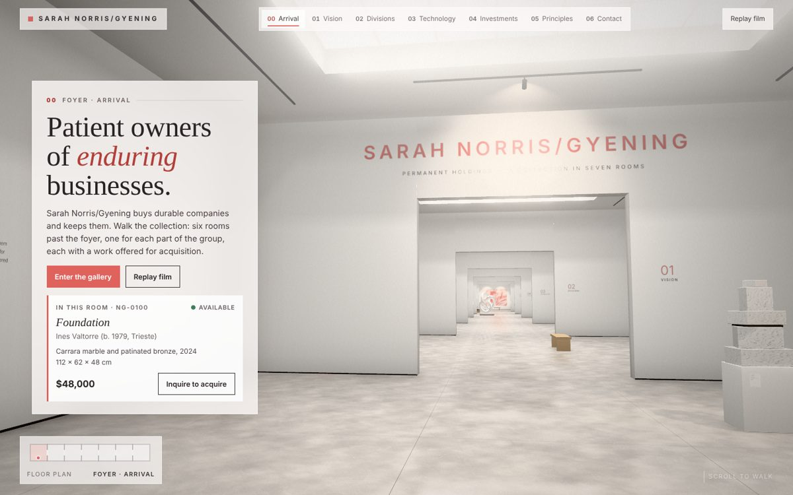
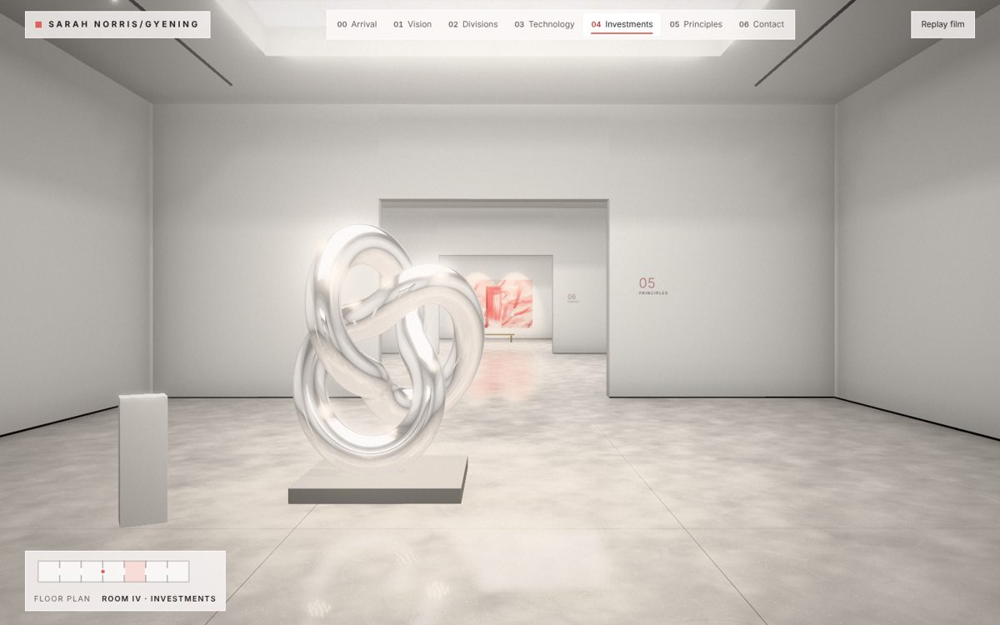
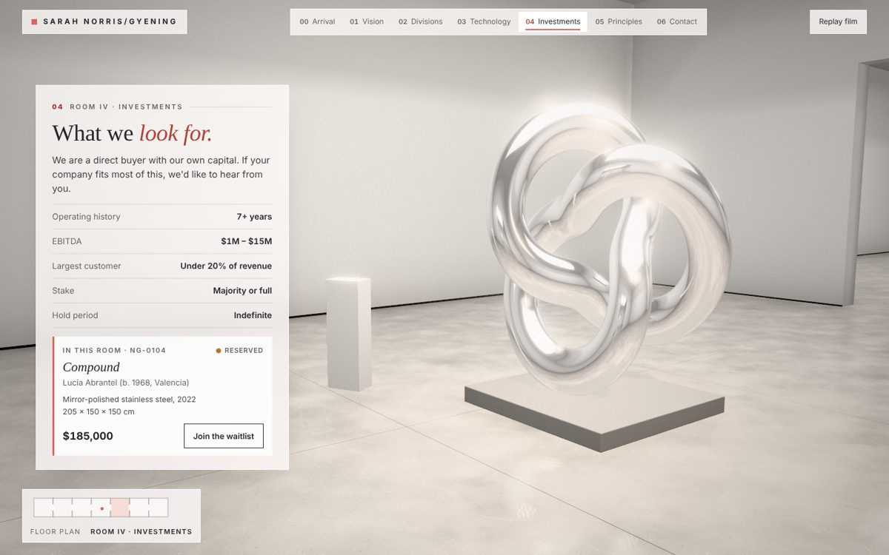
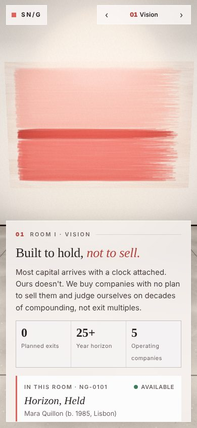

# sarah-gyening-art-gallery

Website repository for Sarah Norris Gyening Art Gallery.

The site is a walk-through 3D gallery for **Sarah Norris/Gyening**. It opens on a 15-second film with a Skip button. After that, scrolling moves the camera through seven connected rooms. Each room has one work offered for sale, with a price, a wall label and an inquiry button.



| Walking between rooms | Room IV · Investments | Phone |
|---|---|---|
|  |  |  |

## Rooms

| # | Chapter | Work | Price |
|---|---|---|---|
| 00 | Arrival (foyer) | *Foundation*, marble and bronze sculpture | $48,000 |
| 01 | Vision | *Horizon, Held*, oil on linen | $86,000 |
| 02 | Divisions | *Five Holdings*, five panels | $64,000 the set |
| 03 | Technology | *Signal / Noise I–III*, framed prints, edition of 12 | $9,800 each |
| 04 | Investments | *Compound*, polished stainless steel | $185,000 (reserved) |
| 05 | Principles | *Line of Conduct*, oil and graphite | $42,000 |
| 06 | Contact | *Open Door*, oil and cold wax | $72,000 |

Artists, prices, division names and the contact address (`inquiries@norrisgyening.com`) are **placeholders**. Edit them in `src/content.js` and `src/template.html`.

## How it's built

- **three.js 0.186.1**, bundled by esbuild into one self-contained page: `docs/index.html`. It needs no server and loads no images from outside; only the Google Fonts stylesheet comes from another host.
- **Everything is generated in the browser at load:** the concrete floor, marble, oak, wall text, wall labels and all seven artworks are painted on canvas. Nothing is a stock photo.
- **Lighting:** the ceiling skylights are pre-computed into each vertex, with soft shadowing where walls meet the floor. Track spotlights light each work, the floor has a blurred reflection, and a gentle bloom, vignette and grain finish the image.
- **Camera:** the opening film is a keyframed shot in which the lights come on room by room. The scroll path runs through the doorways and pauses at each work. A light, constant drift keeps the gallery alive while you read.
- **Speed:** the page lowers its resolution automatically on slow devices. On phones and small screens it drops the floor reflection and shadows.
- **Reduced motion:** with that setting on, the film doesn't play by itself and moving between rooms cuts straight to the next room instead of flying there.
- **Links:** `#arrival`, `#vision`, `#divisions`, `#technology`, `#investments`, `#principles` and `#contact` open straight to that room and skip the film.

## Files

```
src/
  main.js        renderer, film, scroll journey, UI wiring
  world.js       building geometry, light baking, spotlights, hanging the works
  journey.js     camera stops, path through the doorways, film keyframes and cues
  art.js         the seven artworks (procedural painting)
  textures.js    floor, marble, oak, laylight, shadows, wall text, wall labels
  content.js     works, chapters, divisions (placeholder data)
  util.js        noise, brush strokes, normal maps
  template.html  page markup and styles; the bundle is inlined at /*__APP__*/
scripts/
  build.mjs      builds docs/index.html
  screenshot.js  headless render checks (optional, needs Playwright)
docs/
  index.html     the built site (GitHub Pages)
```

## Develop

```bash
npm install
npm run build          # writes docs/index.html
```

Open `docs/index.html` in a browser, or serve the folder: `npx serve docs`.

Optional render check (needs Playwright with Chromium):

```bash
npm i -D playwright && npx playwright install chromium
node scripts/screenshot.js desk film=0.8,13 p=0,1,2,3,4,5,6
node scripts/screenshot.js mob p=0,1
```

## Publish with GitHub Pages

Settings → Pages → Build and deployment → Deploy from a branch → `main` / `/docs`.
